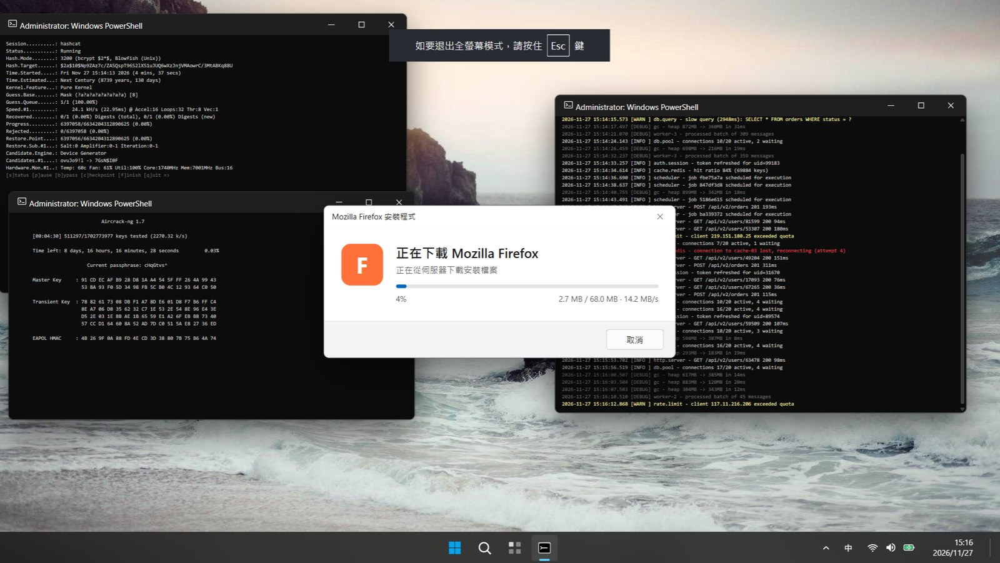

# busy



模擬 Windows 11 桌面的單頁網頁：桌面上有 PowerShell 視窗，持續顯示編譯、下載、日誌、安裝、密碼比對與破解、系統更新等畫面；手機另有更新與充電的全螢幕畫面。

單一 `index.html`，沒有框架、沒有外部 script，直接開啟即可使用，也可放在 GitHub Pages。

## 使用方式

直接開啟 `index.html`，電腦預設跑  `multi` ，手機跑 (`iphone` ` android`）或 `charge` 隨機或用網址參數指定模式，例如 `index.html?mode=install`。


## 組合模式

這幾個模式會同時或輪流跑多個畫面：

| `?mode=` | 內容 |
| --- | --- |
| `multi` | 多視窗：一定有 `install`，再隨機加 1～3 個其他終端機畫面，每個畫面一個視窗，一直循環；手機改為上下堆疊（最多 3 個） |
| `mixed` | 混合：每跑完一輪就隨機換成另一個模式，一直循環 |
| `random` | 隨機單一：隨機選一個單一畫面模式，一直重複跑 |
| `phone` | 手機畫面（手機預設）：自己品牌的更新畫面或 `charge`，隨機二選一 |

## 單一畫面模式

### 電腦（桌面 + 終端機）

| `?mode=` | 內容 |
| --- | --- |
| `compile` | 編譯：cargo build 或 cmake，帶進度條與警告 |
| `download` | 下載：多檔同時下載，顯示進度條、速度、ETA |
| `log` | 伺服器日誌：INFO、DEBUG、WARN、ERROR 分色 |
| `pkg` | 套件更新：winget upgrade 風格 |
| `install` | 安裝程式：桌面跳出安裝視窗，連續安裝 4～6 個常用軟體（Chrome、Firefox、LINE、Microsoft 365、7-Zip、Notepad++、Acrobat Reader、Zoom、VLC、VS Code、Teams 隨機抽），終端機同步跑安裝日誌 |
| `aircrack` | 密碼比對：aircrack 風格的畫面（目標網路列表、已測試金鑰數與速度、剩餘時間、目前比對的密碼、跳動的金鑰十六進位值） |
| `hashcat` | 密碼破解：hashcat 風格的狀態畫面（啟動訊息、Speed、Progress、Time.Estimated、Candidates、Hardware.Mon）；每輪隨機選 WPA / bcrypt / sha512crypt 其中一種 |
| `update` | 系統更新：全螢幕藍底畫面，0% → 100% → 重新啟動，循環 |

`aircrack` 與 `hashcat` 的行為：

- **單獨執行**：永遠跑不完，不會顯示「找到密碼」。`aircrack` 的密碼欄、`hashcat`（改用 8 位任意字元的遮罩攻擊）的候選密碼一直跳隨機字元。
- **在 `mixed` 中**：每輪最長 10 分鐘，或在某個進度顯示綠色結果（`KEY FOUND!` / `Status: Cracked`）；`hashcat` 改為字典攻擊。
- 兩者都是**純視覺模擬**，網路名稱、MAC、雜湊值與密碼全是隨機假資料，不會做任何實際的事。

### 手機（全螢幕）

| `?mode=` | 內容 |
| --- | --- |
| `iphone` | iPhone 風格更新畫面：全螢幕黑底，中間為白色蘋果圖示，下方一條細白色進度條，沒有文字。跑滿後停頓，再重新開始 |
| `android` | Android 風格更新畫面：全螢幕黑底，中間為會轉動齒輪的 Android 小綠人，下方是寬圓角綠色進度條與百分比。跑滿後停頓，再重新開始 |
| `charge` | 電池充電畫面：全螢幕黑底，中間為動態充電電量環、電池液位與閃電圖示，顯示充電百分比與預估時間。跑滿後停頓，再重新開始 |

## 規則補充

- 在 `mixed` 中，`aircrack`、`hashcat`、`multi` 每輪最長 10 分鐘。
- 指定單一模式時，只會重複跑該模式（包含手動指定 `?mode=iphone`、`?mode=android`、`?mode=charge`）。
- 一輪的長短依模式與速度而定：編譯、下載、日誌、套件更新約數十秒到數分鐘；安裝程式是一整串軟體；系統更新為完整的 0% → 100% → 重新啟動。
- 速度每 10 秒隨機變化一次，範圍 0.1 ～ 0.4 倍；需要調整時，修改 `index.html` 中的 `pickSpeed`。
- 模式說明也寫在 `index.html` 最上方的註解裡。

## 手機

- **Android（Chrome）**：點一下螢幕進入全螢幕（沒有任何提示文字，第一次點擊時才會進入）。
- **Android 免提示的做法**：全螢幕時 Android 系統會自己跳出「從頂端向下拖曳…即可退出全螢幕模式」的提示，網頁無法移除。改在 Chrome 選「加到主畫面」或「安裝應用程式」，再從桌面圖示開啟，就是獨立視窗（沒有網址列、沒有這個提示），只保留系統狀態列。需要透過 HTTPS（例如 GitHub Pages）開啟。
- **iPhone（Safari）**：網頁無法全螢幕。請用「分享 → 加入主畫面」，再從主畫面圖示開啟，就不會有網址列與工具列。
- 窄螢幕（寬度 700px 以下）時，桌面模式的視窗會縮到符合螢幕寬度，工作列只保留時鐘等必要項目。
- 在手機上指定桌面模式（例如 `?mode=log`、`?mode=multi`）也可使用，視窗操作支援觸控：拖曳標題列移動、拖曳右下角縮放、雙點標題列最大化／還原，桌面圖示單點即開啟。

## 桌面操作

桌面行為比照一般電腦：

- 視窗可拖曳、縮放（右下角）、最小化、最大化、關閉；雙擊標題列可最大化或還原。
- 終端機視窗會保留歷史輸出（最多 600 行）並自動往上捲動，每輪跑完不清空畫面，也可使用滑鼠滾輪往上回捲檢視。
- 工作列圖示：未開啟或已最小化時開啟，在最上層時最小化，被蓋住時移到最上層。開啟「本機」或「資源回收桶」時，工作列會多出對應圖示。
- 工作列右下角（Wi-Fi / 音量 / 充電電池圖示區）：電池圖示具有動態充電動畫；點擊該區域可開啟「電源與電池」面板，檢視充電狀態或預覽全螢幕充電畫面（點擊畫面或按 `Esc` 返回桌面）。
- 開始選單永遠顯示在所有視窗之上；選單內的 PowerShell、File Explorer 可開啟視窗。
- 桌面圖示：「本機」、「資源回收桶」可雙擊開啟；Microsoft Edge 圖示為通用的地球圖示，沒有開啟功能。
- 安裝程式視窗可拖曳標題列移動。

## 檔案結構

```
busy/
├─ index.html   主程式（App 的 manifest 與圖示都內建在這個檔案裡）
├─ sw.js        最小 Service Worker（網路優先，離線時用快取）
└─ README.md
```

- `manifest` 與圖示由 `index.html` 在執行時產生，不需要 `manifest.json` 和圖片檔。
- `sw.js` 無法內建（瀏覽器規定 Service Worker 必須是獨立檔案），它只用來讓瀏覽器把網頁視為可安裝的 App；沒有它，網頁本身仍可正常使用。
- 桌面上顯示的 App 名稱可在 `index.html` 搜尋 `short_name` 修改。
- 更新 `index.html` 後，已安裝的 App 會在連網時自動取得新版（網路優先）。

## 注意事項

- 桌面壁紙預設內建經典藍天綠地桌布（Base64 內嵌於 `index.html`）；連網時有 75% 機率載入 `https://picsum.photos/1920/1080/` 的隨機圖片、25% 機率使用內建桌布，離線或載入失敗時皆自動使用內建桌布。
- 這是純前端的模擬畫面，不會執行任何真實的編譯、下載、安裝或破解。
